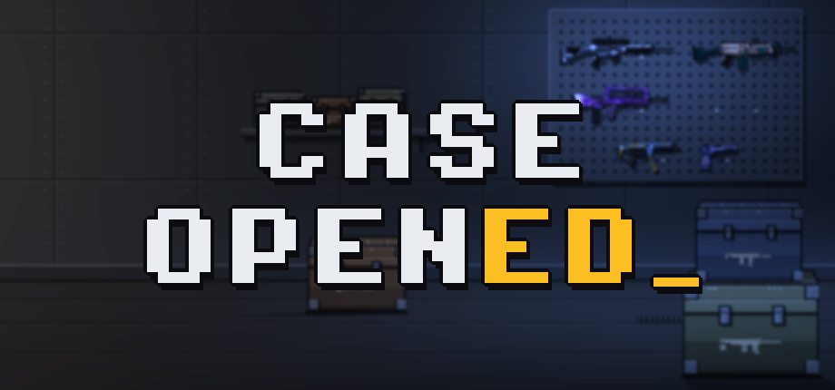
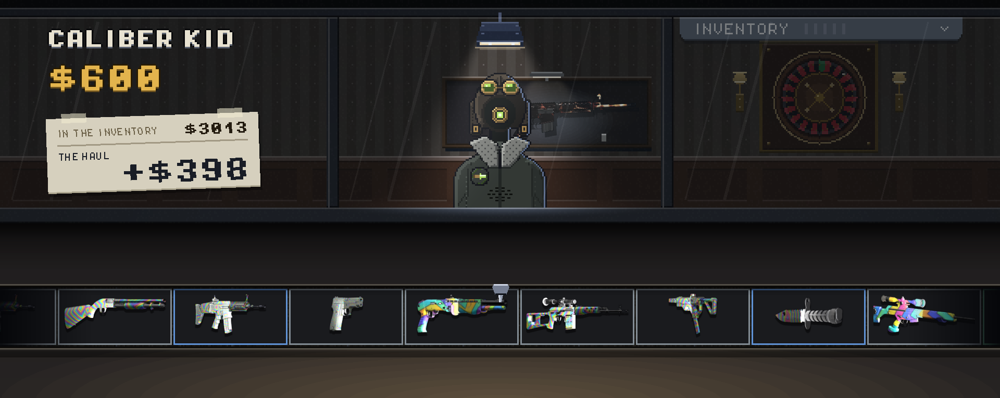
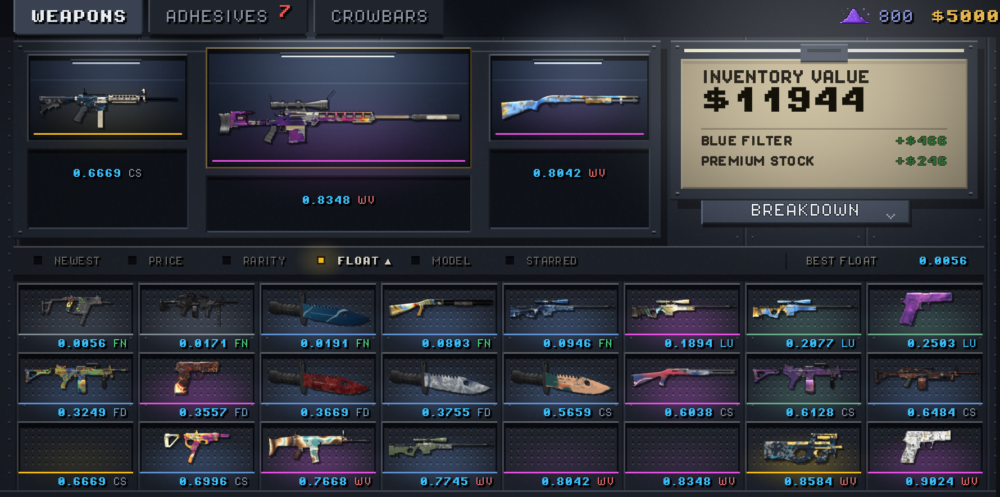
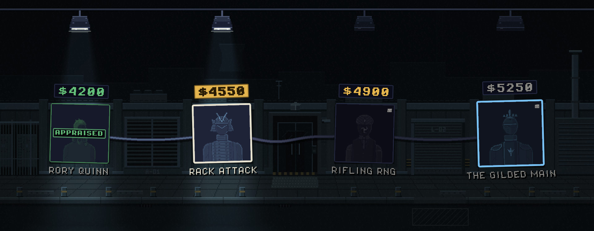
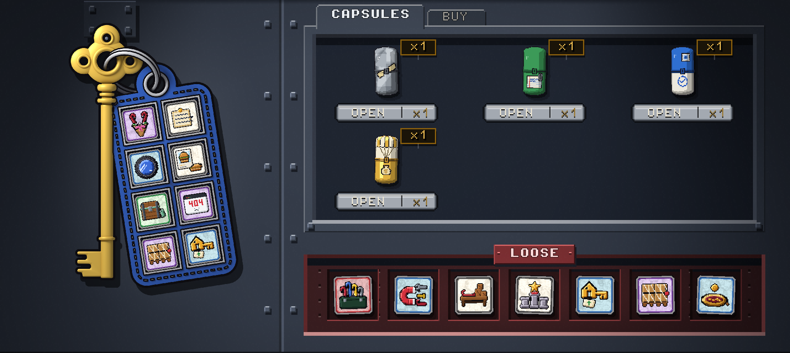
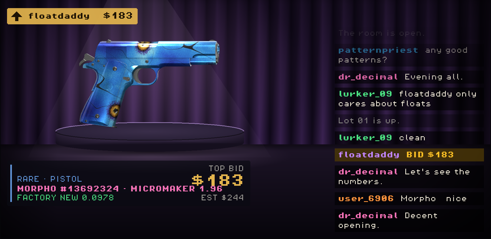

# Case Opened

Jogo de abertura de caixas para PC, feito em Godot 4.

**[Página na Steam](https://store.steampowered.com/app/5329660/Case_Opened/)**

> O código do jogo é privado. Este repositório apresenta o projeto.

## A ideia

Na maioria dos jogos de abrir caixas, o item só vale pelo que dá para vender ou trocar. Em Case Opened, o que importa é a coleção inteira.

A campanha tem 24 fases, divididas em seis setores. Em cada fase um avaliador define uma meta, e o valor total da sua coleção precisa chegar nela. Bater a meta não custa nada, porque todas as armas continuam com você. O jogador decide quais caixas comprar, quais itens guardar e como combinar os modificadores para a coleção alcançar o valor pedido.

Quando o projeto começou, procurei outros jogos do gênero com essa mecânica e não encontrei nenhum.

## O que tem no jogo

- 13 caixas e mais de 360 armas, em seis raridades
- Desgaste individual em cada arma, que muda o valor dela
- Cerca de 140 adesivos para montar na Chave Mestra, onde a ordem dos efeitos faz diferença
- 29 pés de cabra que abrem caixas com regras diferentes
- Contratos, mercados, leilões e outros desvios ao longo da rota
- Um chefe no fim de cada setor e um modo infinito depois da fase 24
- Partidas com semente: a mesma semente sempre gera a mesma partida
- Conquistas na Steam
- Pixel art feita à mão e trilha sonora original
- Textos em inglês e português

## De onde veio

O projeto começou como um experimento meu de geração de imagens com matemática em Python. Esse trabalho virou a base visual das armas: cada uma recebe a aparência a partir de um tema e de uma semente própria, aplicados em tempo real por um shader.

## Parte técnica

- Regras do jogo separadas da interface, com o conteúdo em arquivos de dados
- Cada sistema usa sua própria sequência de números aleatórios a partir da semente da partida
- Saves gravados de forma atômica, com checksum SHA-256 e cópia de segurança
- Testes automatizados que rodam sem abrir a janela do jogo, cobrindo regras, economia e regressões
- Integração com a Steam pelo GodotSteam

| | |
|---|---|
| Motor | Godot 4.7, GDScript |
| Ferramentas | Python (NumPy, PIL, SciPy), Blender |
| Integrações | Steamworks |
